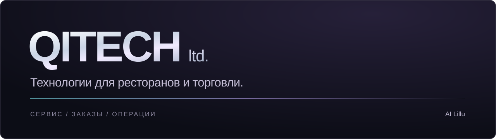

  

  <a href="https://hello.ailillu.kz/"><strong>Сайт и продукты ↗</strong></a>
  &nbsp; · &nbsp;
  <a href="https://hello.ailillu.kz/new/">Интерактивная презентация ↗</a>
  &nbsp; · &nbsp;
  <a href="mailto:hello@ailillu.kz">Связаться</a>

Создаём цифровые продукты для ресторанов: от заказа гостя до закупок и склада. Объединяем обслуживание, собственные каналы продаж и операционные процессы вокруг данных **iiko и Poster**.

### Продукты AI Lillu

| Направление | Что делаем |
| :--- | :--- |
| [QR-меню и AI-официант](https://hello.ailillu.kz/product/qr-menu) | Меню, рекомендации и заказ со смартфона гостя. |
| [Киоски самообслуживания](https://hello.ailillu.kz/product/kiosk) | Выбор блюд и оформление заказа на экране киоска. |
| [WhatsApp-оператор](https://hello.ailillu.kz/product/whatsapp) | Прямой канал общения и приёма заказов. |
| [Приложение и web-заказ](https://hello.ailillu.kz/product/app) | Собственные цифровые каналы под брендом ресторана. |
| [Закупки и склад](https://hello.ailillu.kz/product/warehouse) | Заявки поставщикам, приёмка, распознавание накладных и учёт. |
| [Resonto](https://hello.ailillu.kz/product/resonto) · [AI-аналитик](https://hello.ailillu.kz/product/analytics) | Работа с отзывами и операционными данными. |

### Для разработчиков

[**iiko Server API SDK →**](https://github.com/smart-ordering/iiko_server_api_sdk) — открытый Rust SDK для интеграции с iiko Server API.

---

[Посмотреть продукты](https://hello.ailillu.kz/) · [Обсудить интеграцию](mailto:hello@ailillu.kz)
